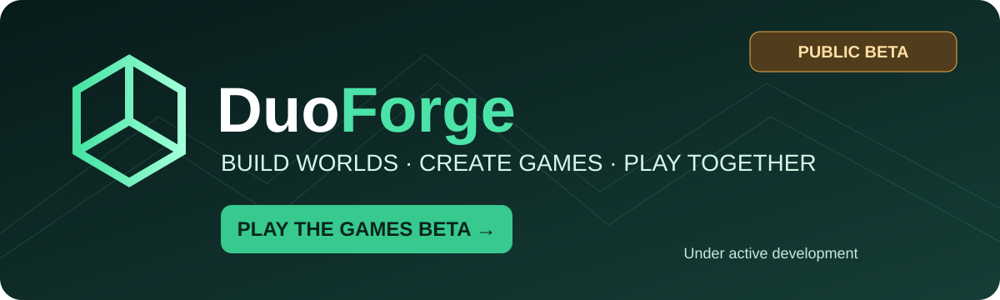

# 🎮 DuoForge — Build a World Together

> **🚧 PUBLIC BETA · UNDER ACTIVE DEVELOPMENT**  
> DuoForge is an evolving game-creation platform. Features, game content and performance may change; bugs and unfinished experiences are expected. This repository is a **public preview**, not the complete production source.

**Build worlds. Create games. Play together.**  
DuoForge explores a shared creative space where game makers, artists and players can develop experiences together.

### ▶️ [PLAY GAMES — OPEN DUOFORGE BETA](https://duoforge-gaming.cuddlyelk8.chatgpt.site/games)

**Want to try it now?** Open the Games page above to discover and play available experiences. No GitHub installation is required to visit the game catalogue.

## Discover DuoForge

| Explore | Description |
| --- | --- |
| 🎮 **[Play Games — main platform](https://duoforge-gaming.cuddlyelk8.chatgpt.site/games)** | The main place to discover and test available games. |
| 🌍 [Community showcase](https://mattd81.github.io/DuoForge-Preview/showcase/) | Learn about our collaborative game-world vision. |
| 🧩 [Game Builder preview](https://mattd81.github.io/DuoForge-Preview/game-builder/) | Experimental browser-based game creation. |
| 🛠️ [3D Studio preview](https://mattd81.github.io/DuoForge-Preview/workshop/studio/) | Explore evolving 3D creation tools. |
| 🕹️ [Public GitHub preview](https://mattd81.github.io/DuoForge-Preview/) | Independent technical demonstrations and experiments. |

## Our vision

**Imagine → Create → Play → Improve → Share.**

A world builder creates a place. An artist brings its characters to life. A developer adds gameplay. Players test the experience and help it evolve. DuoForge aims to make those contributions part of a growing creative ecosystem.

### What we're working on

- **Game creation:** approachable tools and prototypes for building playable experiences.
- **3D tools:** model editing, materials, GLB workflows and visual experiments.
- **Rendering:** experiments with real-time graphics, lighting and performance.
- **Mobile play:** responsive layouts, touch controls and gamepad experiments.
- **Collaboration:** a long-term direction for sharing worlds, assets and contributions.

These are **areas of development**, not a claim that every capability is complete or integrated in production.

## 📸 Project visuals

The graphics above are **illustrative project artwork**, not screenshots of the live application. To evaluate the actual product, use the live links above.

## 🧪 Beta notice

This is a work in progress. Some previews may differ from the main DuoForge platform, and not every experiment is connected to production. If something fails, please report the game or preview URL, device/browser, steps to reproduce and expected behaviour.

[**Report a bug or suggest an improvement**](https://github.com/MattD81/DuoForge-Preview/issues)

## For developers

This repository publishes selected previews and technical experiments. The full DuoForge Sites platform and private projects are **not** published here. Please respect contributors' work, third-party licenses and the boundary between public demonstrations and private production code.

**Maintainer:** [MattD81](https://github.com/MattD81)  
**Project:** DuoForge — bygg spel tillsammans  
**Tagline:** *Build a world together. Make every creator part of the adventure.*

---

**🚀 [PLAY THE DUOFORGE GAMES BETA →](https://duoforge-gaming.cuddlyelk8.chatgpt.site/games)**
